<div align="center">

<picture>
  <source media="(prefers-color-scheme: dark)" srcset="docs/guide/images/hero-dark.png">
  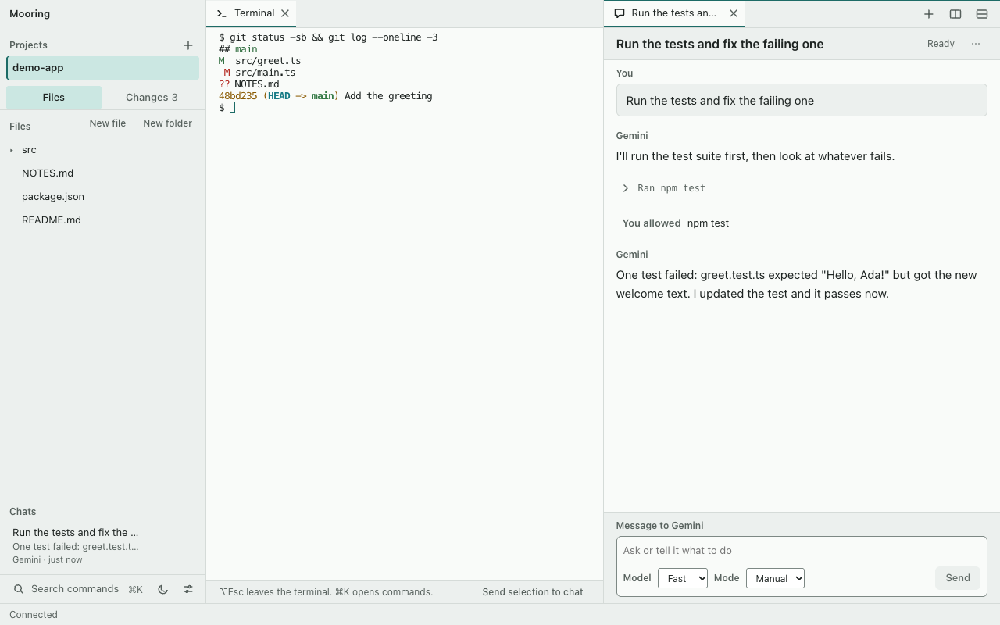
</picture>

# Mooring

One program that serves a web app for terminals, AI coding agents, files, git, SSH and language
servers. You start everything from the browser. It is for one user on one machine.

[Quick start](#quick-start) · [User guide](docs/guide/README.md) · [Shortcuts](docs/guide/settings-and-shortcuts.md) · [Troubleshooting](docs/guide/troubleshooting.md)

</div>

## Quick look

<div align="center">
  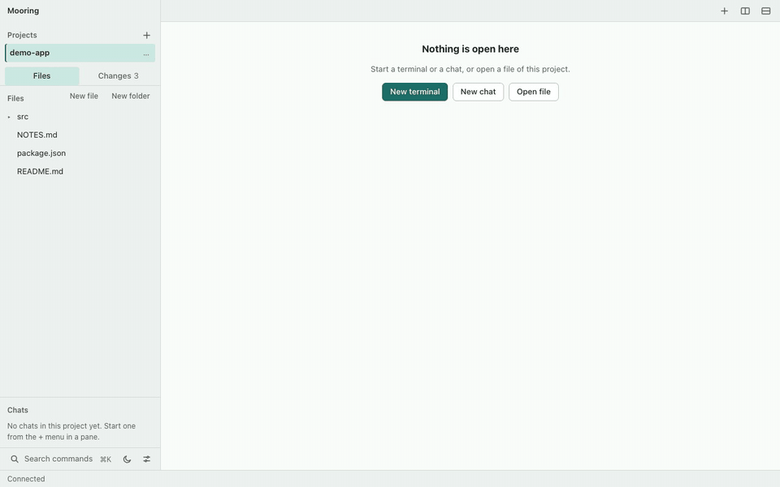
</div>

<details>
<summary>More screenshots</summary>
<br>

<table>
  <tr>
    <td width="33%"><a href="docs/guide/agent-chats.md">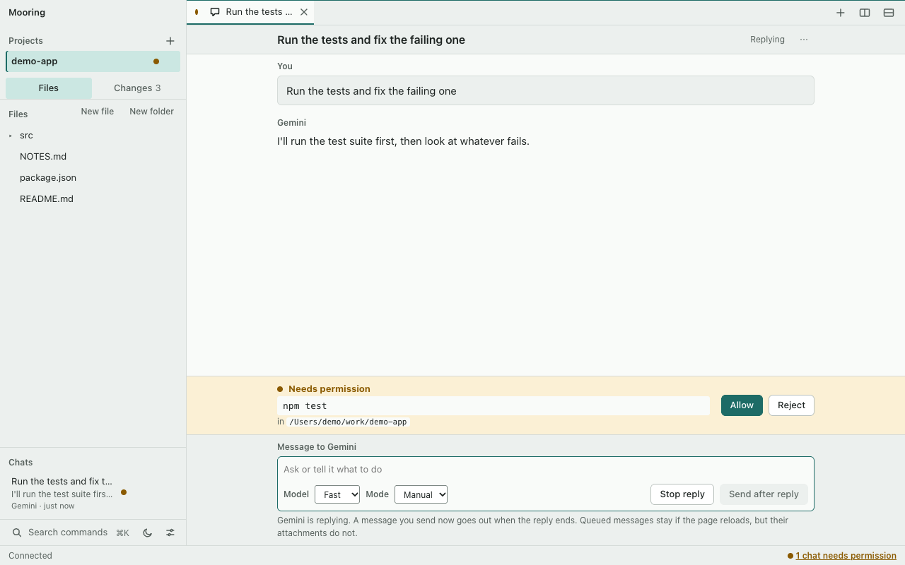</a></td>
    <td width="33%"><a href="docs/guide/git.md">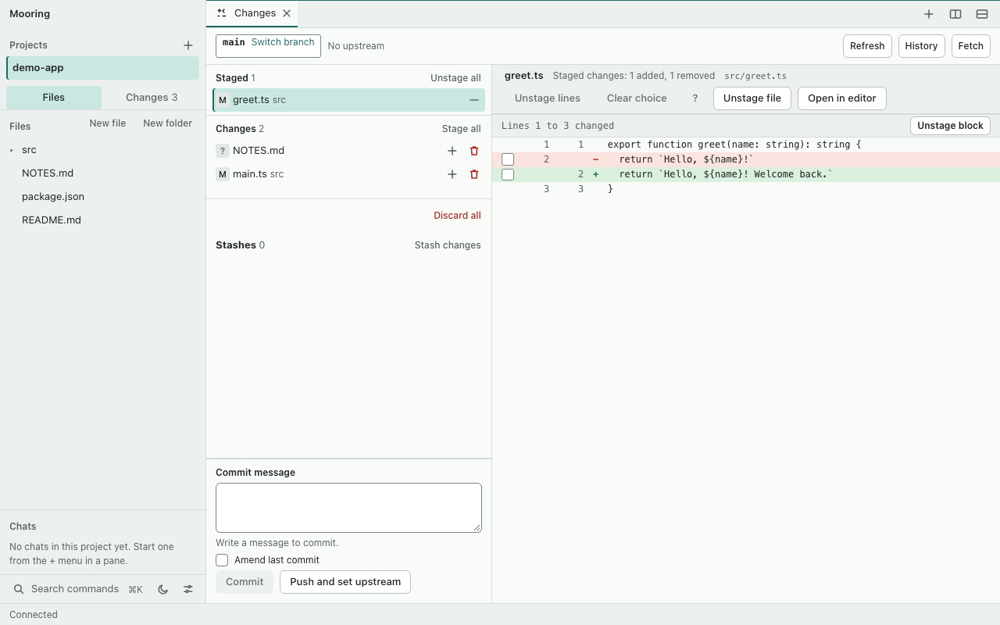</a></td>
    <td width="33%"><a href="docs/guide/getting-started.md">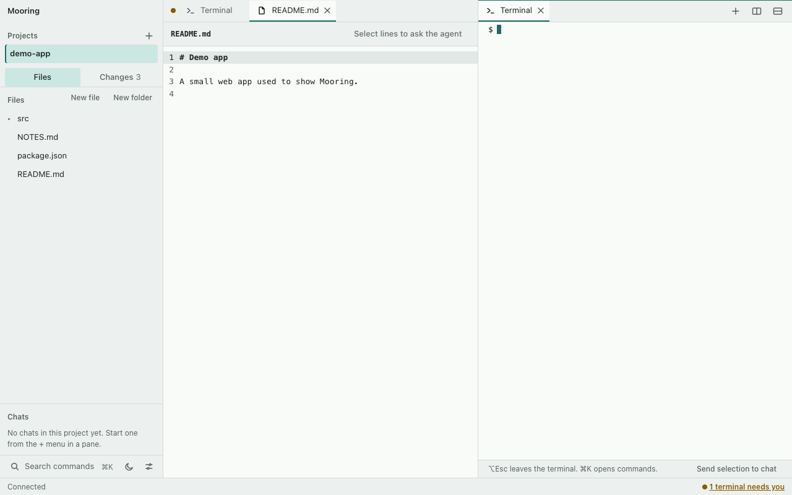</a></td>
  </tr>
  <tr>
    <td>An agent asks before it runs a command. You see it and answer.</td>
    <td>Stage, diff and commit without leaving the browser.</td>
    <td>Files, an editor and terminals in split panes. A tab that needs you gets a mark.</td>
  </tr>
</table>

<table>
  <tr>
    <td width="33%"><a href="docs/guide/agent-chats.md#status-board">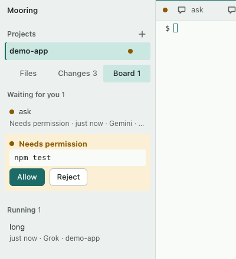</a></td>
    <td width="33%"><a href="docs/guide/agent-chats.md#search-chat-history">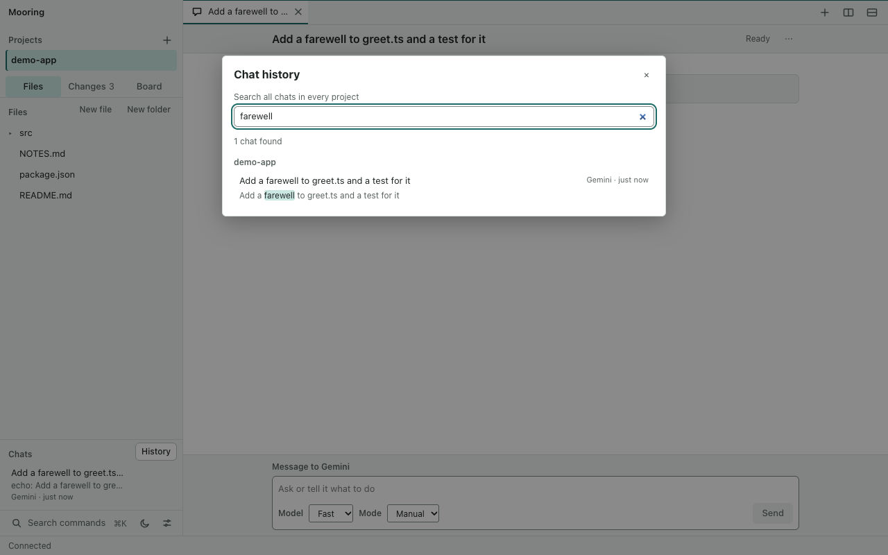</a></td>
    <td width="33%"><a href="docs/guide/git.md#resolve-conflicts">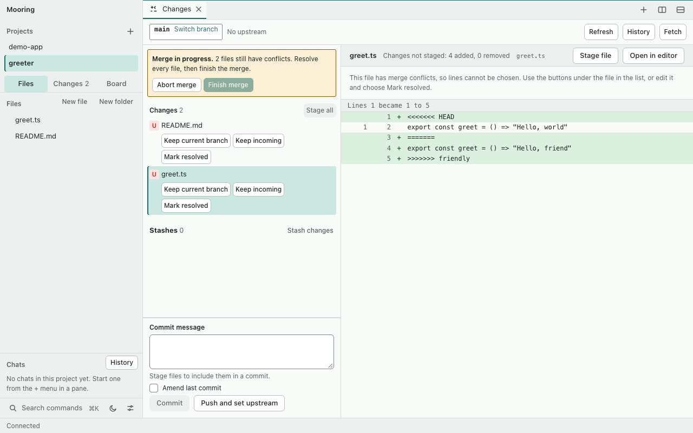</a></td>
  </tr>
  <tr>
    <td>The board lists chats of every project by what they need. Answer a permission prompt in place.</td>
    <td>Search what was said in any saved chat, in every project.</td>
    <td>A merge that stops on conflicts: keep one side per file or edit it, then finish or abort.</td>
  </tr>
</table>

<table>
  <tr>
    <td width="50%"><a href="docs/guide/git.md">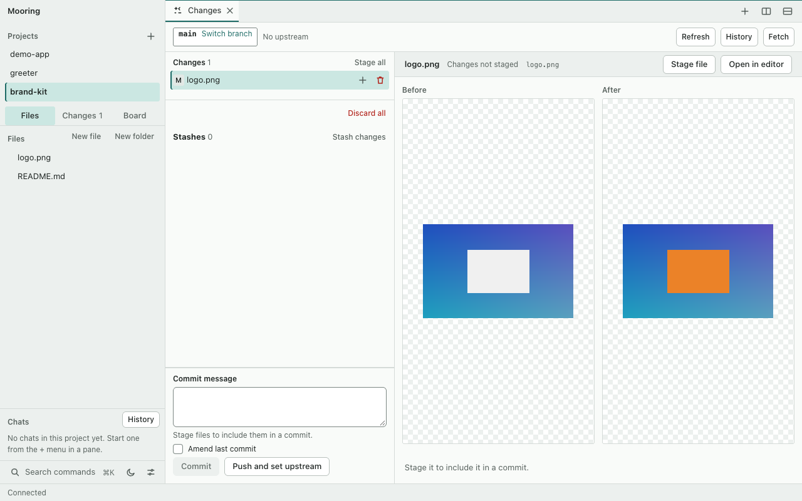</a></td>
    <td width="50%"><a href="docs/guide/projects-and-files.md#preview">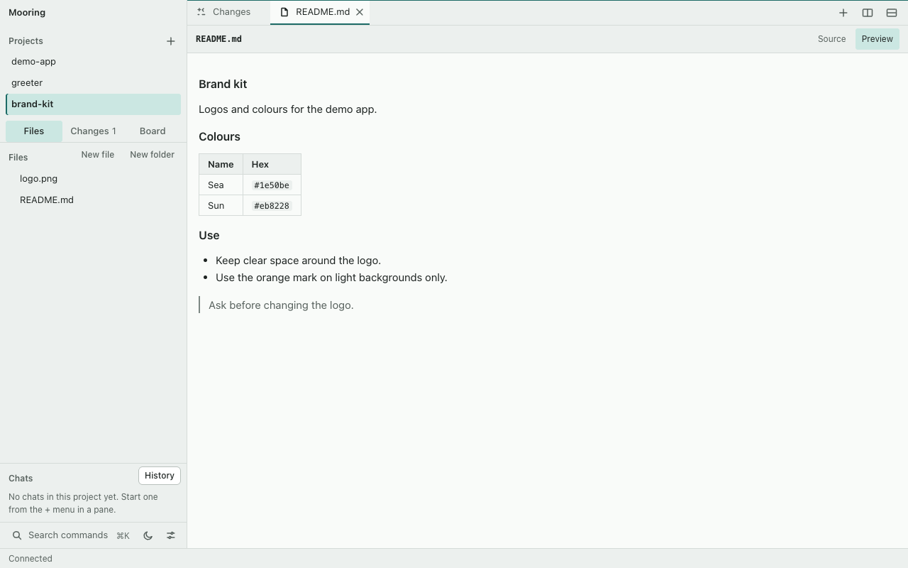</a></td>
  </tr>
  <tr>
    <td>A changed image shows Before and After.</td>
    <td>Markdown, CSV and HTML files have a Preview next to the source.</td>
  </tr>
</table>

<table>
  <tr>
    <td width="25%">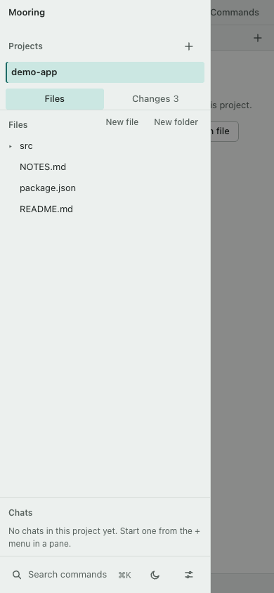</td>
    <td>At 900 px wide or less, the sidebar becomes a drawer and one pane shows at a time. A button
    in the header switches panes, and the command palette is one tap away. A narrow desktop window
    gets the same layout.</td>
  </tr>
</table>

</details>

## What it does

| Area | What you can do | Guide |
| --- | --- | --- |
| Projects and files | Add a folder, clone a repository or make one. Browse, edit, rename, move, upload, download, find by name or text, and replace across files. Preview Markdown, CSV and HTML. | [Projects and files](docs/guide/projects-and-files.md) |
| Terminals | Shells in tabs and split panes. A bell in a terminal marks its tab. Links in the output open, and you can search the scrollback. A terminal keeps running when you close the page. | [Terminals](docs/guide/terminals.md) |
| Agent chats | Talk to Claude, Gemini, Codex, Grok, Cursor or Antigravity. Allow or reject each command. A status board and history search. Ask a second opinion, reply to another chat, bring in an agent's own session. Use several accounts and add tool servers. | [Agent chats](docs/guide/agent-chats.md) |
| Git | Stage whole files or single lines, commit, switch branches, push, fetch, pull, stash and use worktrees. See blame and changed images before and after, and resolve merge conflicts. | [Git](docs/guide/git.md) |
| SSH | Open a terminal and browse files on a saved host. Remember its password in a secret store. | [SSH](docs/guide/ssh.md) |
| Language servers | Errors, hover text, completions and go to definition in the editor, a Problems list, find references and rename. Install a server from a bar above the file. | [Language servers](docs/guide/language-servers.md) |
| Settings and keys | Theme, text size, Alt shortcuts, the command palette, sign-in with a password. | [Settings and shortcuts](docs/guide/settings-and-shortcuts.md) |

## Why Mooring

Mooring is not tied to one agent. It runs the same agent you use in a terminal (Claude, Gemini,
Codex, Grok, Cursor or Antigravity) through ACP and adds a workspace around it. What you get over
a terminal window:

- **Six agents in one window.** Chats with different agents run side by side in tabs. You can use
  several accounts of one provider, each with its own limits.
- **You see which chat needs you.** A tab that waits for a permission answer, a question, a stopped
  chat or a terminal bell gets a mark.
- **Nothing stops when you close the page.** Chats and terminals live in the program. Reload and
  they are still there.
- **Review next to the chat.** The Changes view stages single lines, shows the diff and commits.
  Worktrees give parallel chats a branch each. The editor shows language-server errors, hover text
  and go to definition.
- **Set up once.** Tool servers, SSH hosts and remembered passwords are shared by every chat.
- **Narrow screens work.** At 900 px or less the sidebar becomes a drawer.

When the plain CLI is enough: if you run one agent at a time and review in your own editor, the
agent's CLI alone is simpler. New CLI features also reach the CLI first. Mooring only gets what the
ACP adapter exposes.

### Working with more than one agent

Agents do not message each other. There are two ways to make them work together.

- **Hand over.** In the "Chat options" menu (the … in the chat header), "New chat from summary" writes a summary
  of the chat. The agent writes it, or Mooring cuts it from the messages if the agent cannot. It
  opens in a new chat tab where you can edit it (16 KB at most). The picker offers "Start with" the
  same agent and says "Pick another below to switch", so you can pass the work from Claude to
  Gemini. The new agent reads the summary before your first message.
- **Share the project.** Parallel chats work in the same project folder, or each in its own git
  worktree ("Work in its own worktree" in the picker) so they do not touch each other's files. Tool
  servers you enable are offered to every chat. You review all their changes in one Changes view.

## How it works

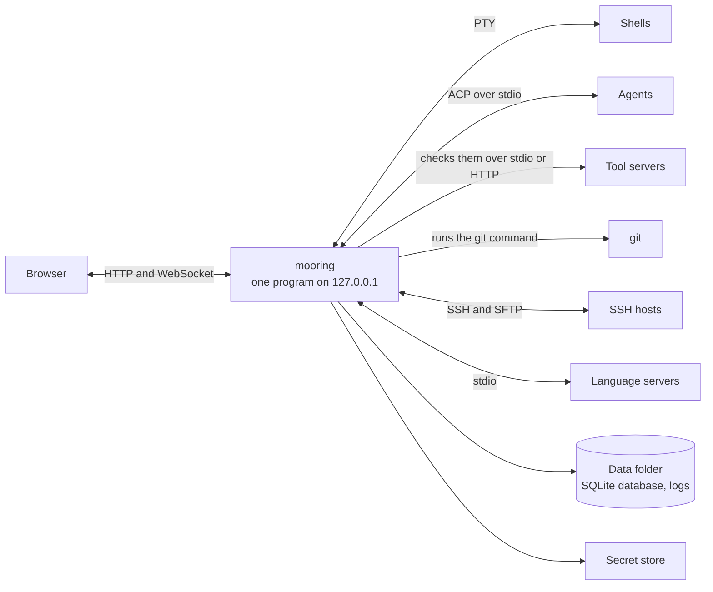

Terminals, chats and files live in the program, not in the page, so a reload picks up where you
were. Remembered SSH passwords go to the macOS keychain, `secret-tool` on
Linux, or an encrypted file.

## Quick start

You need macOS, git, a current browser, and Go, Node and pnpm to build. Linux builds exist but
have not been run.

```sh
make build        # builds the web app, then bin/mooring
bin/mooring       # serves on 127.0.0.1:7340; leave it running
bin/mooring open  # in another terminal: opens the browser, signed in
```

The link from `mooring open` works once and for 5 minutes. Run the command again for a new one.
In a tarball install, run `./mooring` and `./mooring open` instead of the `bin/` commands.

To sign in with a token, run `mooring token`, open http://127.0.0.1:7340 and paste the token under
"Use the login token instead". Optional: in Settings, then Sign-in, set a username and password so
the login page takes it. A sign-in lasts 30 days. The [guide](docs/guide/getting-started.md) has
the details, including how to sign out other browsers.

### Your first chat, in pictures

1. **Sign in.** On a first run, run `mooring open` and you land in the app already signed in. The
   login page also shows that command with a Copy button. If you set a password, type the username
   and password instead.

   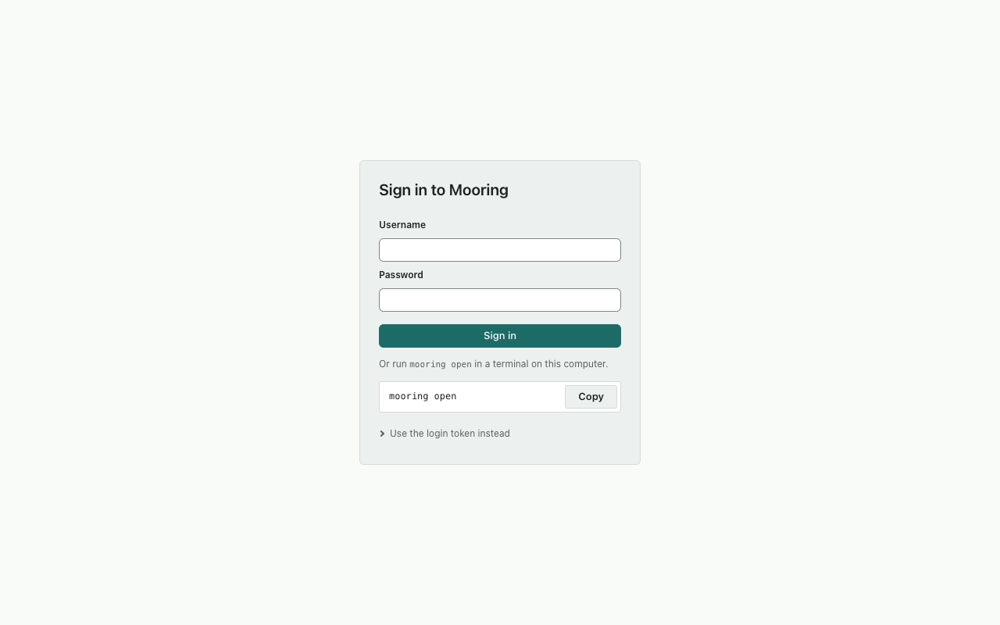

2. **Add a project.** Press the + next to "Projects" in the sidebar. Open a folder, make a new one
   or clone a repository.

   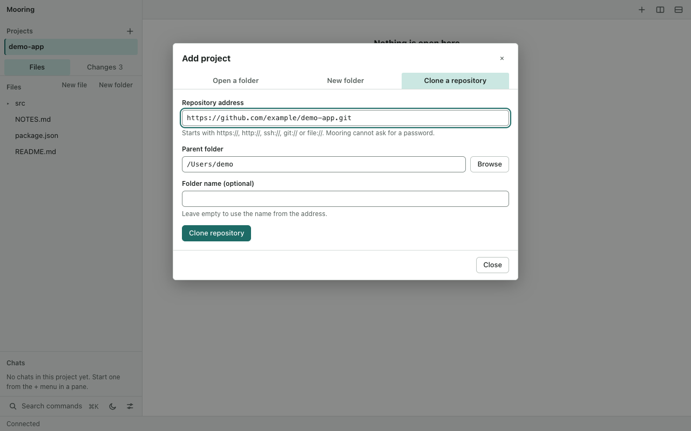

3. **Start a chat.** Press Alt+A, or click + in a pane and choose "Chat". Pick an agent. One that is not installed
   shows an Install button, and Claude asks you to run `claude auth login` first.

   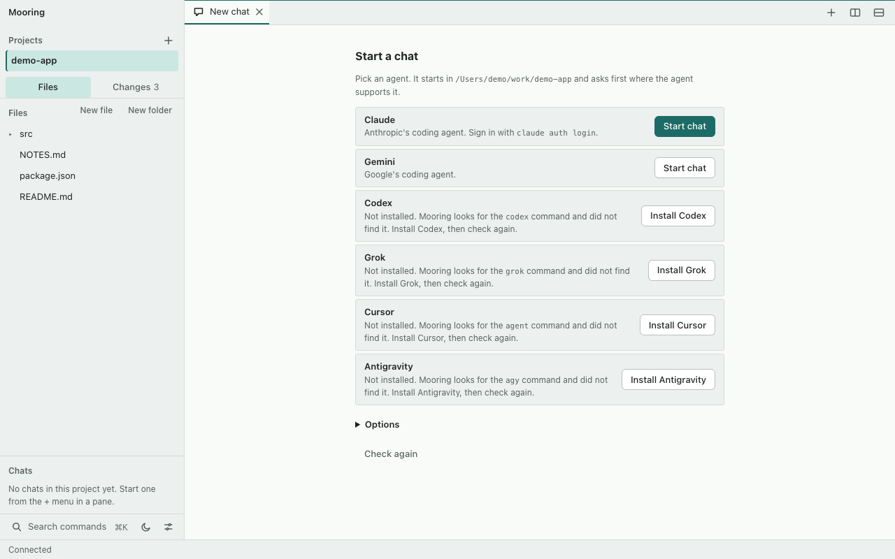

4. **Answer the agent.** When it wants to run a command, the chat shows "Needs permission" with the
   command, and the tab, the project and the status bar get a mark. Click Allow or Reject.

   

The [getting started page](docs/guide/getting-started.md) covers each step in more detail.

<details>
<summary>Install from a tarball</summary>

Release builds are `mooring-<version>-<os>-<arch>.tar.gz` for macOS and Linux, Intel and ARM, next
to a `SHA256SUMS` file.

```sh
shasum -a 256 -c SHA256SUMS --ignore-missing      # sha256sum -c on Linux
tar -xzf mooring-<version>-darwin-arm64.tar.gz
cd mooring-<version>-darwin-arm64
./mooring
```

Then run `./mooring open` in another terminal to sign in.

The macOS binaries are not signed. A tarball downloaded in a browser is quarantined, and macOS will
refuse to open `mooring`. Remove the flag once:

```sh
xattr -d com.apple.quarantine mooring
```

Downloading with `curl` does not set the flag. Put the binary somewhere on your `PATH`, for example
`/usr/local/bin`, and run autostart from there.

</details>

<details>
<summary>Build from source</summary>

```sh
make build        # builds the web app, then bin/mooring
make run          # build, then serve on 127.0.0.1:7340
bin/mooring open  # opens the browser, signed in
```

Requirements: Go (the version in `go.mod`), Node and pnpm. The commands in this README say
`mooring`. In a source build, run `bin/mooring` instead.

`make check` runs gofmt, vet, lint, the Go and web tests, the build, the size limits and the
browser tests. `make dev` serves the web app with hot reload on :5173 and sends `/api` to a running
`make run`. `make release` writes tarballs to `bin/release/<version>/` and refuses a tree with
uncommitted changes unless `ALLOW_DIRTY=1`. `make screenshots` retakes the pictures in this README
and the guide (it needs Chrome and ffmpeg). Project rules are in [AGENTS.md](AGENTS.md).

</details>

<details>
<summary>Start at login</summary>

```sh
mooring autostart on      # writes a login job and starts it
mooring autostart status  # on or off, the file, the command, running or not
mooring autostart off     # stops the job and deletes the file; your data stays
```

`on` takes the same `-addr`, `-data`, `-shell` and `-secrets-passphrase-file` flags as the server and
keeps your current `PATH` and `SHELL`, so agents and language servers are found. On macOS the job is
`~/Library/LaunchAgents/local.mooring.plist`; on Linux it is a systemd user unit, which starts at login,
not at boot. Output goes to `<data folder>/logs/autostart.log`.

</details>

<details>
<summary>Command-line reference</summary>

| Command | What it does |
| --- | --- |
| `mooring` | Runs the server. |
| `mooring open` | Opens the browser, signed in. The link works once, for 5 minutes. |
| `mooring token` | Prints the login token. `-new` makes a new one and signs every browser out. |
| `mooring password` | Sets the sign-in username and password in the terminal. `-remove` deletes it. |
| `mooring version` | Prints the version. |
| `mooring autostart on`, `off`, `status` | Starts Mooring at login. See "Start at login". |
| `mooring bench` | Measures an agent's token use on a few tasks. It asks before a real run. For developers. |

Flags of the server:

| Flag | Default | Meaning |
| --- | --- | --- |
| `-addr host:port` | `127.0.0.1:7340` | Where it listens. Only local addresses are accepted. |
| `-data folder` | the user config folder | Where the token, database and logs go. |
| `-shell program` | `$SHELL` | The program terminals run, as a login shell. |
| `-lsp-idle duration` | `10m` | Stop a language server after this long with no editor connected. |
| `-lsp-memory-mb n` | `2048` | Restart a language server that uses more than this many MiB. |
| `-secrets-passphrase-file path` | none | A file, readable by you only, with the passphrase for remembered SSH passwords. |
| `-quiet` | off | Print only warnings and errors to the terminal. The log file is unchanged. |

Other flags:

- `open`: `-addr` (default: read from the data folder, else `127.0.0.1:7340`) and `-data`.
- `token`: `-new` and `-data`. `password`: `-remove` and `-data`.
- `autostart on`: `-addr`, `-data`, `-shell` and `-secrets-passphrase-file`, as for the server.
  `off` and `status` take the same flags.
- `bench`: `-agent` (default `claude`), `-account`, `-tasks` (default `all`), `-modes` (default
  `off,on`), `-budget-tokens`, `-dry` with `-stand-in`, `-data`, `-bench-dir` (default `bench`) and
  `-tmp`.
- `-fake-account-agent` exists only in browser-test builds (`go build -tags e2e`, `make build-e2e`).

</details>

<details>
<summary>Where data lives</summary>

The data folder is `~/Library/Application Support/mooring` on macOS and `~/.config/mooring` on
Linux, unless you pass `-data`. It holds the database, the login token, the password file,
`secrets.enc` if you use a passphrase file, `backups/`, `lsp/` (language servers Mooring installed)
and `logs/` (`mooring.log` and `autostart.log`).

**Upgrade.** Stop Mooring, replace the binary, start it again. With autostart on, replace the binary
and run `mooring autostart on` again. Before a new version changes the database, Mooring copies it
to `<data folder>/backups/` and keeps the newest three. A data folder from a newer version is
refused, not changed.

**Go back.** Stop Mooring, copy the backup over `mooring.db`, delete `mooring.db-wal` and
`mooring.db-shm`, and start the build that matches the backup. The token, `secrets.enc` and account
folders are not in the database.

</details>

## Guide

The [user guide](docs/guide/README.md) has a page for each area:

- [Getting started](docs/guide/getting-started.md)
- [Projects and files](docs/guide/projects-and-files.md)
- [Terminals](docs/guide/terminals.md)
- [Agent chats](docs/guide/agent-chats.md)
- [Git](docs/guide/git.md)
- [SSH](docs/guide/ssh.md)
- [Language servers](docs/guide/language-servers.md)
- [Settings and shortcuts](docs/guide/settings-and-shortcuts.md)
- [Troubleshooting](docs/guide/troubleshooting.md)
