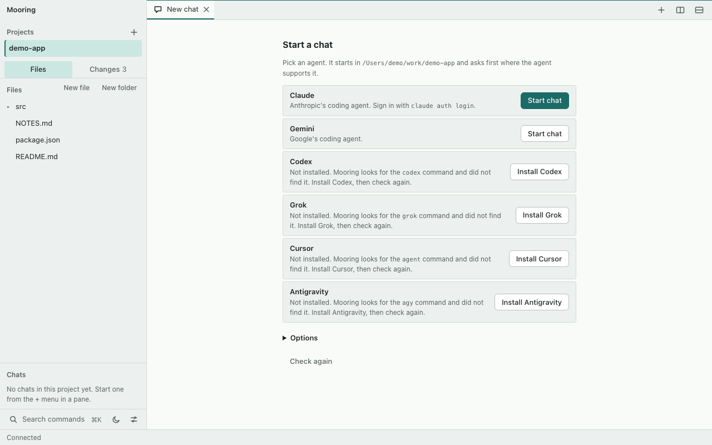
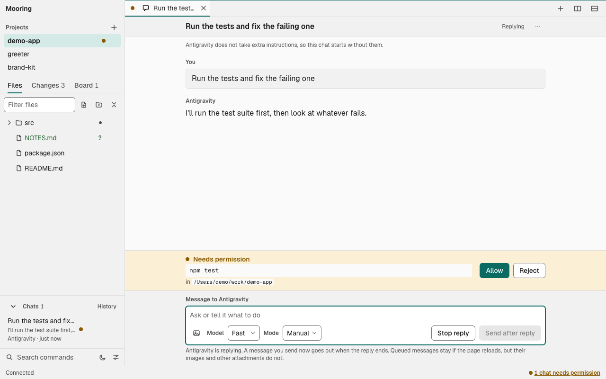
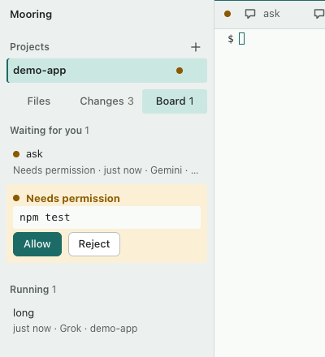
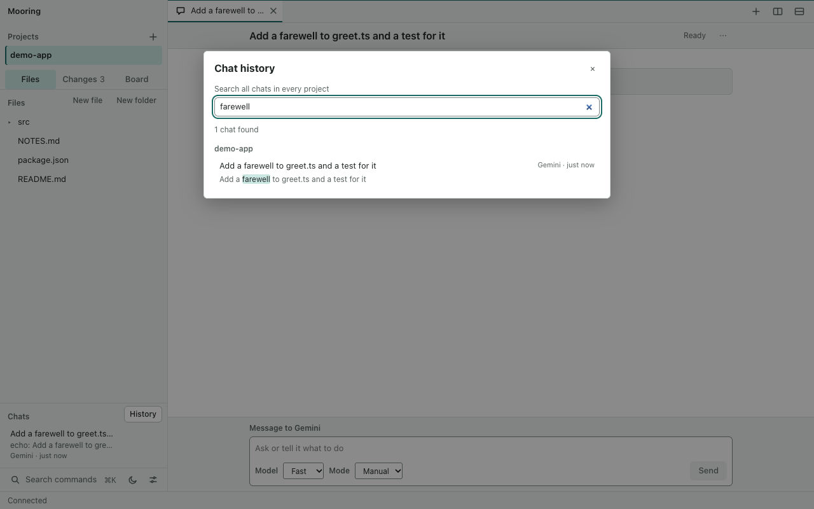
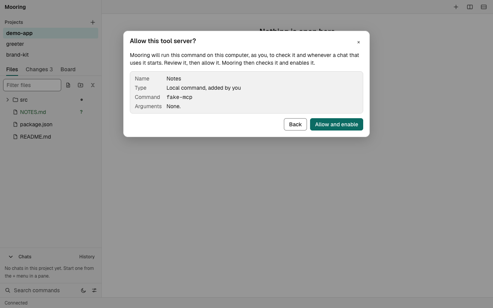

# Agent chats

An agent chat is a tab where you talk to a coding agent that works in your project folder. Mooring
talks to agents over ACP. Mooring does not ship an agent or store your login to one. You install the
agent, and Mooring starts it.

## Supported agents

| Agent | Mooring runs | Needs on PATH | Sign in |
| --- | --- | --- | --- |
| Claude | `npx -y` with the Claude ACP adapter | `npx` | `claude auth login` |
| Gemini | `gemini --acp` | `gemini` | A paid Gemini API key or Code Assist Enterprise. Otherwise use Antigravity. |
| Codex | `npx -y @agentclientprotocol/codex-acp` | `npx` and `codex` | |
| Grok | `grok agent stdio` | `grok` | `grok login`, or set `XAI_API_KEY` |
| Cursor | `agent acp` | `agent` | |
| Antigravity | `agy acp` | `agy` (Google Antigravity CLI 1.5 or later) | Run `agy` once, or `agy acp --login` with no browser |

Mooring finds each program on the PATH of the Mooring process. If you start Mooring from a
terminal, that is your terminal's PATH. With autostart, `mooring autostart on` keeps the PATH from
the moment you ran it, so run it again after you install a new tool. See
[Troubleshooting](troubleshooting.md) if an agent is not found.

## Start a chat

1. Open a project, then press Alt+A, or click "+" in a pane and choose "Chat".
2. Under "Start a chat", pick an agent. The picker says it starts in the project folder and asks
   first where the agent supports it.
3. Click "Start chat".

If the agent is missing, the picker says "Not installed. Mooring looks for the `X` command and did
not find it. Install NAME, then check again." Click "Install NAME" to open a terminal, install it,
then click "Check again".

Options in the picker:

- "Work in its own worktree" starts the chat in a new git worktree. "Branch name (optional)" left
  empty makes a branch that starts with `mooring/`. See [Git](git.md). If the agent can take extra
  folders, the chat also gets the project folder to read, and the header says "Can also read"
  and the project name. Hover it for the path. Agents that cannot do this only see the worktree.
- "Tool servers for this chat" lists your enabled tool servers. Tick the ones this chat may use.
  "Set up tool servers" opens the tool server list. See below.
- If you have chats from before, "Start with X" picks the same agent again.

### Bring in a chat from the agent's own program

If you started a chat in an agent's own program (for example its command line), you can continue
it in Mooring. On the picker, open "Bring in a chat from an agent's own program", pick the agent
if more than one is installed, and click "Find chats from NAME". The agent starts for a moment to
answer, so this can take a few seconds. The palette item "Bring in a chat from an agent's own
program" opens the picker with this part showing.

The list holds the agent's chats for this project folder, newest first, each with its age. A chat
without a title reads "Untitled session" and the start of its id. Chats that already open in
Mooring are left out. Click "Bring in" on one: the chat opens with its earlier messages and you
can carry on.

If nothing is listed, the message says the agent has no chats for this folder that are not
already open here. Not every agent can list and reopen its chats; then the message says that
agent cannot, and the other errors (not installed, not signed in, too slow) say what to do.

## Talk to the agent

Type in the box labelled "Message to AGENT" (placeholder "Ask or tell it what to do"). Enter sends.
Shift+Enter starts a new line. On a touch screen Enter makes a new line instead.

- "Send" sends the message.
- While the agent replies, the button reads "Send after reply". Your message waits in a queue
  labelled "Sends when the reply ends". "Take back" removes it.
- "Stop reply" stops the agent mid-reply.

The model and mode selects, when the agent offers them, are above the box. If you pick a mode that
may run commands and edit files without asking, Mooring asks "This mode may let AGENT run commands
and edit files without asking you first. Switch anyway?" Click "Switch mode" or "Keep asking". If
an agent has no mode that asks before it acts, the chat warns that it may run commands without
asking.

The "Chat options" menu has "Shorten long output", "New chat from summary", "Get a second opinion", a context meter
("Context N of M") and "Cost so far". "New chat from summary" opens a draft of the summary, up to
16 KB, that you can edit before starting a new chat with it. The new chat can use another agent: the
picker offers "Start with" the same agent and says "Pick another below to switch".

### Get a second opinion

"Get a second opinion" in the "Chat options" menu hands a chat's work to another agent for review.
It never runs by itself. It writes the summary as above and opens the picker with the summary
editable. The picker marks the first installed agent that is not the earlier chat's agent as the main
choice; the same agent is still in the list. When the new chat starts, Mooring reads the uncommitted
changes in the earlier chat's folder (the diff against the last commit plus the names of new files, cut
if long) and sends them with the summary. The folder needs a commit, otherwise the chat does not
start. If the earlier chat worked in the project folder and not its own worktree, the changes may
include edits that are not from that chat. The message box of the new chat holds a review request
("Review the work of the earlier chat: ...") that you can edit before you send it. The changes
show in the new chat under "Uncommitted changes sent with the summary".

## Permission prompts and Attention

When the agent wants to run a command or edit a file, the chat shows "Needs permission" with a
button for each option the agent gives. If several are waiting it says "N more waiting".

A prompt, a question, or a stopped chat counts as Attention. The chat shows a mark in the sidebar,
the status bar says how many chats need you, the browser tab title reads "(n) Mooring" and the page
icon gets an amber dot. Click the status bar link to open the Board. To get a browser notification when you are in another tab, open Settings,
Notifications and click "Allow notifications". The notification names the project only.

## Status board

The "Board" switch in the sidebar, next to "Files" and "Changes", lists every chat in every project
in four groups. Groups with no chats are not shown.

- "Waiting for you": a chat with a permission prompt or a usage limit, the one waiting longest first.
  The prompt's buttons are in the row, so you can answer without opening the chat. A usage-limit row has
  no buttons: open the chat to switch account.
- "Running": chats that are replying.
- "Finished since you looked": chats whose agent finished a reply while you were not looking at that
  chat. A reply you stopped, or a summary, does not count. A chat leaves this group when you open it
  or look at it in a pane.
- "Idle": the newest 20 other chats.

Each row shows the title, the agent, the project and how long ago it changed. A finished or idle chat
has a "Reply to" box when the chat is ready for a message: type and press Send, and the message goes to
the agent without opening the chat. A chat that is stopped or not signed in is in "Idle" with that
state named, and has no box.
Click a row to open the chat; if it belongs to another project, Mooring switches to that project first.
While the Board shows it replaces the "Chats" list in the sidebar; click "Files" or "Changes" to go
back. The number on the switch counts chats waiting for you plus chats finished since you looked.
The "needs you" link in the status bar opens the Board, and on a narrow screen it opens the sidebar on
the Board. A terminal that needs you has no row on the Board; with no chat waiting, the link opens it.

## Sessions

Every chat is saved as a Session in the "Chats" list of its project. The list shows each chat's
state: Starting, Replying, Not signed in or Stopped.

- Closing a chat tab stops its agent. The saved chat stays in the list. Click it to open it again.
- A chat that is not running says "X is not running. The messages are saved. Resume to keep going."
  Click "Resume chat".
- Click the pencil to rename a chat. Click the cross to delete it: "Delete this chat?" then
  "Delete" or "Keep". If the agent can delete its own copy of a chat, the question says so
  ("Mooring removes it and asks NAME to delete its own copy"). A chat you brought in from the
  agent's own program is only removed from Mooring; the agent keeps it.
- "Filter chats" appears once a project has more than 5.

## Send a reply to another chat

You can pass one reply of an agent to another chat of the same project, for example to ask Grok
about what Gemini wrote. Nothing is sent unless you press the button. If the chat you picked started answering in the meantime,
the panel shows the error and sends nothing.

1. When a turn has ended, click "Send to another chat" on the row under it, next to "Changed N files"
   if there is one. It sends the last reply of that turn. The button is not there while the agent is
   still working on the turn.
2. Pick a chat. Each line shows the agent, then the chat title. A chat that is answering, starting,
   stopped or not signed in is greyed out and says why in brackets. Only an idle chat can be picked.
3. Optional: type in "Add a note (optional)".
4. Click "Send". The line "Sent to ..." appears with "Open that chat". "Cancel" or Escape closes the
   panel without sending.

The other chat gets a message from you: your note, then the reply quoted with the agent and the chat
title. Above it, "From <agent> · <chat title>" names where it came from. Click the title to open that
chat, if it still exists. If that chat was deleted, the label says so and is not a link. A reply longer than 64 KB is cut, and the message says so. If the project has
no other chat, the panel says so and has a "New chat" button.

## Work with other chats in a group

A group puts 2 or 3 chats of the same project side by side, for example one agent writing and
another reviewing.

1. In a chat, open "Chat options" and click "Group with other chats…".
2. Tick 1 or 2 other chats. Only chats that are not in a group yet are listed.
3. Optional: type a group title. Click "Group chats".

The Chats list shows the group as one row, with its chats nested under it. The row is named by its
title, or "Group: " and the chat titles, and it has the amber mark when any chat in it needs you.
Click the row to open the group tab. Each chat there is a normal chat with its own message box,
and "Send to another chat" works between them. On a narrow window the chats are stacked.

"Leave group" above a chat takes that chat out. A group left with one chat is dissolved.
"Ungroup" in the tab header takes them all out and opens each chat in its own tab. The chats keep
their messages either way. Clicking a chat under the group row still opens it alone.

## Search chat history

To find a chat by what was said in it, click "History" next to "Chats" in the sidebar, press Alt+Y,
or pick "Search chat history" in the command palette. The "Chat history" dialog searches every saved
chat in every project. With nothing typed it lists the newest chats.

- Type words; a chat must have all of them. The last word may be the start of a word.
- Results are grouped by project. Each row shows the chat title, the agent, when it last changed
  and the passage that matched, with the matching words marked.
- Click a row, or press Down to reach it and Enter, to open that chat. If it belongs to another
  project, Mooring switches to that project first.
- The search box takes up to 200 characters.

## Attach files, lines and output

- In the editor, select lines and click "Ask the agent about these lines".
- In a terminal, select text and click "Send selection to chat".
- In a chat, a command's output can be added with "Send full output". "Show raw output" switches
  the view.

These appear as chips above the box. A message takes at most 8 attachments. Attached lines and
terminal text are limited to 64 KB. With several chats open, Mooring asks "Send to which chat?"

## Accounts and Providers

An Account is one login of a Provider (an agent), kept in its own settings folder. Mooring never
reads or stores the login. Only Claude supports separate accounts today.

To add an account:

1. Open Settings and click "Open Accounts", or choose "Accounts and usage" in the command palette.
2. Under the agent, click "Add Claude account". Type a Name such as "Work".
3. Choose "Mooring makes a folder" or "Use a folder I already have" and pick the folder, which
   must be inside your home folder.
4. Click "Add account". A new account starts signed out. Click "Sign in" on its row.

Each row has Sign in, Rename, Make default and Remove. Tags show "Default for new projects", "The
agent's own login", "Folder managed by Mooring" and "Your folder". Usage shows "N% used" per
window, "Limit reached, ..." or "Usage: unknown." When the agent names a window but gives no
percentage (Claude often does), the row says "within limit", "near limit" or "limit reached"
instead. Usage comes from what the agent reports while you chat.

Once the agent has reported usage, the chat header shows the fullest window of the chat's account,
for example "5 hours: 62% used, resets at 14:00". Hover it to see the account and every
window. The same lines are in the "…" menu at any width, under "Plan usage of X", as a list; on a
phone the header stays one row, so they are only there. Nothing shows while usage is unknown.

Each project can use a different account. Pick one under "X account for this project". Changing it
restarts that agent's open chats in the project.

When a chat hits a limit, it says "The usage limit of X was reached." with "Switch to Y" or "Open
accounts". When an account is not signed in it says "X is not signed in." with "Sign in to X" and
"Resume chat".

## Tool servers

A tool server is an MCP server that gives agents extra tools. Nothing runs until you allow it.

To add one from the catalog:

1. Open Settings and click "Open Tool servers", press Alt+M, or use the command palette.
2. Under "Find a tool server", search by name or description. Click "Check for a newer catalog" to
   refresh it, or "Show more" for more results.
3. Click "Add" beside the way you want to run it. Ways are npx, uvx, docker, Remote (http) and
   Local command.
4. On the "Allow this tool server?" screen, read the name, type, command and arguments (or address). Fill the value
   fields. They go to the secret store, not Mooring's database. Click "Allow and enable". "Back"
   goes back.

To add your own, use "Add your own" and fill "How it runs" (a command on this computer, a remote
address over http, or a remote address over sse), Name, Command with "Arguments (optional)", or
Address. "Allow a private address" lets a remote address on your own network through. Click
"Review", then allow it as above.

To check a server, click "Check". Mooring runs it and lists its tools. The first run of an npx,
uvx or docker server downloads it and can take up to 2 minutes. Later checks stop after 30
seconds. A remote check also stops after 30 seconds. Click "Check again" to retry. The row says one
of "Not allowed yet", "Enabled", "Check failed", "Needs a check", "Checked, not enabled", "Needs
sign-in", "Sign-in failed" or "Signed in".

Other row buttons: "Review and allow", Enable or Disable, Edit, and Remove. Remove deletes its saved
values and sign-in. Chats already running keep the server until they stop.

To sign in to a remote server, click "Sign in". Click "Open the sign-in page", which opens a new
tab. On the same computer it finishes by itself. If your browser is on another computer, paste the
address of the page it ended on into "Address of the page it ended on" and click "Finish sign-in".
"Sign out" removes the sign-in.

A chat gets the servers you tick under "Tool servers for this chat" when you start it.

Next: [Git](git.md).
