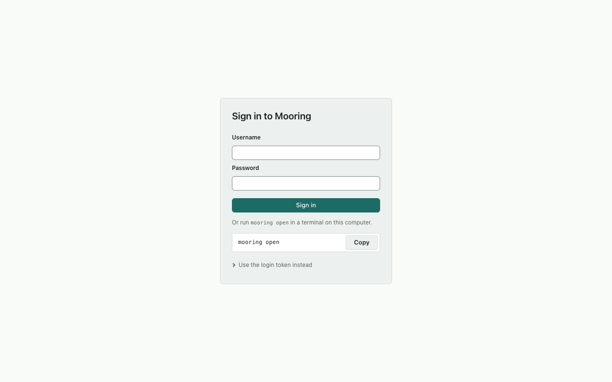
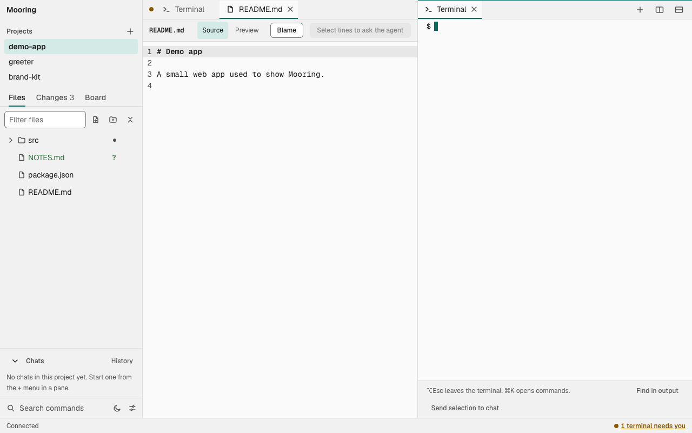
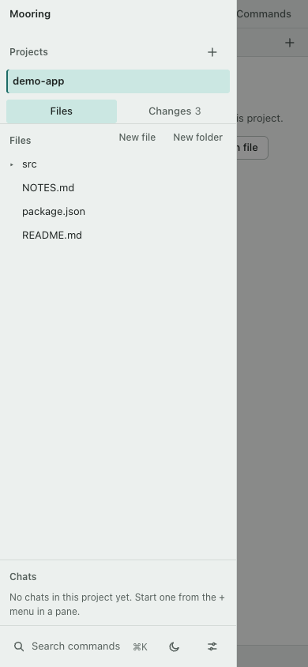

# Getting started

## Start Mooring

Run `mooring` in a terminal. It prints `Mooring is running at http://127.0.0.1:7340` and a
sign-in link. To start it at every login instead, see "Start at login" in the top-level README.

Mooring listens on 127.0.0.1 by default. It refuses any other `-addr` unless you also give it a
TLS certificate and key and a sign-in password. See "Open Mooring from another device" below.

## Sign in

Pick one of these.

To sign in with a link:

1. Run `mooring open` in a terminal on this computer.
2. Your browser opens, signed in. The link works once and for 5 minutes. Run the command again for
   a new one.

To sign in with the token:

1. Run `mooring token` and copy what it prints.
2. Open http://127.0.0.1:7340. The page is titled "Sign in to Mooring".
3. Open "Use the login token instead", paste the token into "Login token" and click "Sign in with
   token".

Once a password is set (next section), the login page shows Username and Password fields and a
"Sign in" button. It still offers `mooring open` and the token.

A sign-in lasts 30 days.



## Set, change or remove a password

A password is optional. It lets a browser save your login. There is one username and one password.

To set a password in the app:

1. Open Settings and find the Sign-in section.
2. Fill in Username, New password and New password again. The password is at least 8 characters.
3. Click "Set password". Mooring says "Password set. The login page now asks for it."

To change it, use the same section: enter the Current password and click "Change password". To
remove it, enter the password under "Password to confirm removal" and click "Remove password".
Changing or removing the password does not sign other browsers out.

To do the same in a terminal, run `mooring password`. It asks for a username, then the new password
twice, and does not echo it. It does not ask for the old password. `mooring password -remove`
deletes the password. Use these if you forgot it. Run them in a terminal on the computer Mooring
runs on.

## Open Mooring from another device

Mooring serves other devices only over HTTPS, and only with a password set. It refuses a
non-local `-addr` without both. To set this up:

1. Get a certificate and key (PEM files). Either run `tailscale cert <machine>.<tailnet>.ts.net`,
   which gives a certificate that browsers trust, or use `mkcert`. With mkcert, install its root CA
   on the other device too, or that device's browser shows a certificate warning. Keep the key
   file readable by you only.
2. Run `mooring password` and set a username and password.
3. Start Mooring with the address and the two files. The address can be `0.0.0.0:7443` or the
   Tailscale IP:

   ```sh
   mooring -addr 0.0.0.0:7443 -tls-cert machine.crt -tls-key machine.key
   ```

4. On the other device, open the https address Mooring prints. Use a name that is in the
   certificate. Any other name gets a 403. Sign in with the username and password. The login token
   also works but is long to type.

To start it this way at every login, give the same flags to `mooring autostart on`.

On this computer, `mooring open` still works. Before it hands over the sign-in link, it checks
that the running server presents the certificate file it was started with, so a certificate you
made yourself is accepted.

Sign-in failures are counted per client address, 5 per minute, so a wrong guess from another
device does not lock you out here. Mooring ignores `X-Forwarded-For`, so behind a reverse proxy all
clients count as one address.

## Sign out, and sign out other browsers

"Sign out" is at the bottom of Settings and in the command palette. It signs out this browser only.

To end every other sign-in:

1. Open Settings, Sign-in.
2. Under "Sign out other browsers", enter your password and click the button. This browser stays
   signed in. A password must be set first.

"Sign out other browsers" also replaces the login token, so older tokens and sign-in links stop
working. `mooring token -new` does more. It makes a new token and signs every browser out,
including this one.

To sign in on another browser, use `mooring open` for a link, or paste the token (or use the
password, if you set one).

## The screen

On a wide window you see three areas.

- The sidebar on the left. The header says "Mooring". Under "Projects" you see one row per project
  and an "Add project" button. Below that is a switch between "Files" and "Changes", then the
  "Chats" list for the open project. The footer has "Search commands", a theme button and
  "Settings". Drag the edge of the sidebar to resize it.
- The panes. Each pane has tabs for terminals, agent chats and files. A pane with no tabs says
  "Nothing is open here" and offers "New terminal", "New chat" and "Open file".
- The status bar at the bottom. It shows "Connected", "Connecting to the server…" or
  "Reconnecting to the server… Changes are kept and sent when it is back." It also shows language
  server progress and a button that counts what needs you, such as "2 chats need you".



The "+" button in a pane opens the new-tab menu: Terminal, Chat, Open file, Split right and
Split down.

Attention means something waits for you: a permission prompt or question in a chat, a chat that
stopped, or a terminal that rang its bell. It shows in the status bar, as "(n) Mooring" in the
browser tab title, and as an amber dot on the page icon.

## Phone layout

At 900 px wide or less, Mooring switches to a phone layout. A narrow desktop window gets it too.

- The sidebar becomes a drawer. Open it with the "Projects" button in the header. Escape closes it.
- The header also has a "Commands" button for the command palette.
- One pane shows at a time. A "Pane N of M" button switches panes, and "More pane actions" opens
  the pane menu.
- Terminals get a row of keys (Ctrl, Esc, Tab and the arrows).
- The Text size setting is ignored.



Next: [Projects and files](projects-and-files.md).
