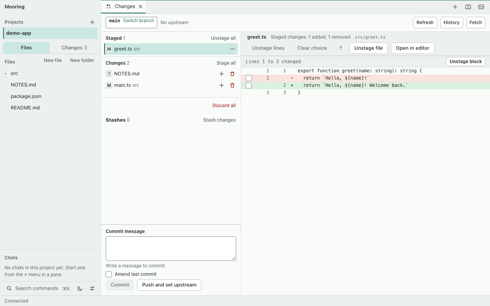
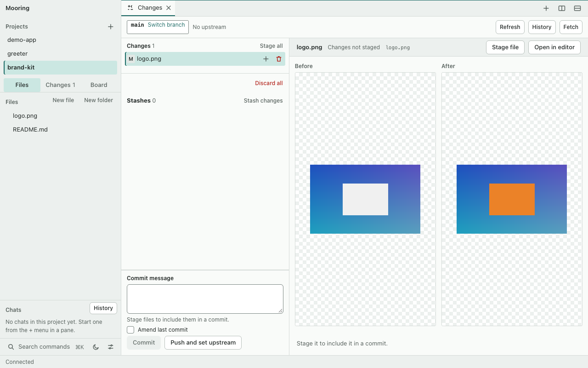
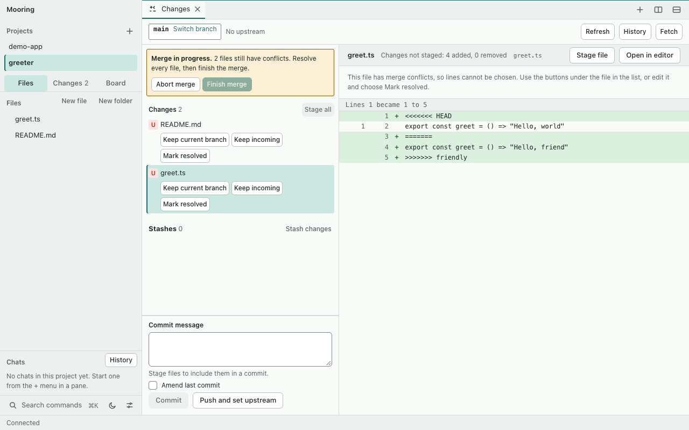

# Git

Mooring needs git 2.20 or newer on the computer it runs on. It runs the same git you use in a
terminal, in the project folder.

## Open the changes view

Click "Changes" in the sidebar to see a summary: the branch, "N changed files" and, when there is
a conflict, "Some files have merge conflicts." Click "Open changes", or press Alt+G, to open the
full view in a pane.

- If the folder is not a repository, you see "This folder is not a git repository. To start one,
  open a terminal here and run `git init`." Click "Open a terminal here".
- If nothing changed, you see "No changes. Everything is committed (last commit X)."
- A "Worktree" select at the top switches between "Project folder" and any worktree.

## Stage and unstage

Changed files are in two lists, "Staged" and "Changes", each with a count.

1. Click a file to see its diff.
2. Press Space on the row, or click its stage button, to stage it. Press Space again on a staged
   file to unstage it. "Stage all" and "Unstage all" do a whole list.
3. Up and Down move through the rows and show each diff.

To stage only some lines:

1. Open the diff of a file.
2. Click lines, shift-click, or drag. With the keyboard, arrows move, Space chooses a line and B
   chooses its block. On a touch screen, tap lines.
3. Click "Stage lines" (it shows the count). In the staged view the button reads "Unstage lines".
   "Clear choice" drops your choice.

A diff over 2 MB is not shown: "This diff is over 2 MB, too large to show here. Open a terminal and run git diff for this file."

A changed picture (PNG, JPEG, GIF, WebP, AVIF, BMP, ICO or SVG) shows both versions side by side,
"Before" and "After", one above the other on a phone. A version that is not there, such as the
"Before" of a new file, says "Not in this version". Other binary files and pictures that cannot
be read say "This is a binary file, so there are no lines to show." The same view opens from a
commit.

Other diff buttons: "Stage file" or "Unstage file", "Open in editor", and "Show unstaged changes"
or "Show staged changes".

## See what the agent changed in its last turn

Above the file list, "Uncommitted" shows your working copy as before. "Last turn" shows only what
one chat's agent changed during its latest turn, so your own edits made before the turn do not
appear. The scope names the chat ("Last turn of <chat title>"). It is the chat in the focused tab;
with several chats in the project, the list next to it picks another.

Before and after each agent turn Mooring records the folder as a checkpoint, without touching your
staged changes, branches or stashes. The list shows each file with Added, Changed, Deleted or
Renamed and its line counts. Click a file for its diff. This view is read-only: nothing can be
staged here. Until a chat has finished a turn with a checkpoint, the view says "<chat> has not
finished a turn with a checkpoint yet."

Settings, under Token saving, has "Save a checkpoint before each agent turn" for the open project.
It is on unless you turn it off. Files in .gitignore are not recorded.

## Comment on diff lines and send them to a chat

In any diff (uncommitted, a commit, or Last turn) point at a line and click "Comment on line N".
Type the note in "Comment for the agent" and click "Add comment". Each comment can be edited or
removed under its line. Comments are kept in this browser tab until you send or discard them.

The bar under the diff says how many comments are waiting. "Send to chat…" puts all of them in the
message box of a chat: for each one the file and line, the quoted line in a code block, then your
comment. If several chats are open it asks which one. You read and send the message yourself; the
comments are cleared once they are in the box. "Discard comments" drops them. All comments together
may be 64 KB at most.

## Discard changes

Select a file and press Delete, or click "Discard all" for every unstaged file. Mooring asks
"Discard X? ... A copy goes to the trash first, so you can get it back from there." Click "Discard"
or "Keep changes". Where there is no trash, it says "There is no trash available here. Discard X
for good? ... This cannot be undone." and the button reads "Discard for good". "Discard all" skips files with
merge conflicts.

## Commit

1. Stage the files.
2. Type in "Commit message". The help line under it says what a commit will include. It reads
   "Stage files to include them in a commit." until something is staged, and "Write a message to
   commit." until you type one.
3. Click "Commit", or press Cmd+Enter (Ctrl+Enter elsewhere) in the message box.

To change the last commit, tick "Amend last commit". The button becomes "Amend commit". With an
empty message the old message stays. Mooring refuses to amend a commit that is already on the
upstream: "The last commit is already on the upstream. Changing it would need a force push, which
Mooring does not do."

If you turned on "Suggest commit messages" in Settings, a "Suggest message" button writes a
message from the staged changes. See [Settings and shortcuts](settings-and-shortcuts.md).

If git does not know who you are, Mooring says "Git does not know who you are. Set user.name and
user.email with git config on the computer running Mooring, then commit again."

## Push, fetch and pull

- "Push" sends your commits. It reads "Push N commits" when you are ahead. If the branch has no
  upstream, it reads "Push and set upstream". Mooring pushes to `origin`. With no `origin` but one remote, it uses that one. With
  several remotes and no `origin`, it stops with "This repository has no remote called origin to
  push to."
- "Fetch" reads the remote. It tells you how many new commits there are, or "Already up to date."
- "Pull N commits" shows only when you are behind. Pull is fast-forward only. If your branch and
  its upstream both have new commits, it stops with "Pull stopped: your branch and its upstream
  both have new commits. Merge or rebase in a terminal."
- A rejected push says "The remote has commits you do not have. Pull first." and offers a "Pull"
  button.
- If the remote wants a login, Mooring says "The remote wants a login that Mooring cannot ask for.
  Set up an SSH key or a credential helper on the computer running Mooring."

The line under the branch name reads "N ahead, M behind UPSTREAM", or "No upstream".

## Resolve conflicts

When a merge, rebase, cherry-pick, revert or patch apply stops on conflicts, the Changes view shows a banner such as "Merge in progress" with Abort and Finish (Continue, for a rebase). Finish stays off while any file still conflicts. A conflicted file has three buttons under its name:

- Keep current branch or Keep incoming: take that whole version of the file. In a rebase these read Keep the base and Keep your commit.
- Mark resolved: use the file as it is on disk. Edit the file first (Open in editor on its diff) and remove every `<<<<<<<`, `=======` and `>>>>>>>` line. Mooring refuses while markers remain.

When every file is resolved, Finish makes the merge commit (or moves a rebase to its next commit, which can stop again). Abort asks first, then puts the branch and files back as they were before the operation.

## Branches

To switch or make a branch:

1. Press the branch button at the top of the changes view, or use "Switch branch" in the command
   palette. The popover says "Switch to a branch, or name a new one".
2. Type to filter. Click a branch to switch to it. The list is the local branches, newest commit
   first.
3. To make a branch, type a new name and click "Make branch NAME". It starts from the current
   commit.

A name that already exists is refused: "A branch with that name already exists. Pick another
name."

## History

Click "History" or press Alt+H. The list shows commits with a graph. "Search the history" takes
text, and "Look in" chooses Message, Author or "Code changed". Click a commit to see its changes.

## Stashes

"Stash changes" under "Stashes" saves your staged and unstaged changes and goes back to the last
commit. You can type a Message (optional) and tick "Include untracked files". Each stash has View,
Apply, Pop and Drop. Dropping asks first and cannot be undone.

## Worktrees

A worktree is another folder with its own branch, from the same repository.

To start a chat in a worktree, tick "Work in its own worktree" in the chat picker. The chat header
shows "Worktree BRANCH" and "Open changes".

In the changes view, choose the worktree in the "Worktree" select to see its changes. "Terminal
here" opens a terminal in it. To remove a worktree, choose it, click "Remove worktree", and
confirm: "Remove this worktree? The folder goes to the trash. Its branch and commits stay..." with
"Remove folder" and "Keep it". Mooring refuses if the worktree has uncommitted changes or new
files, and says "A chat or a terminal is still using this worktree. Stop the chat or close the
terminal first." if one is open.

The command palette also has "Show changes in worktree B", "Show history of worktree B" and "New
terminal in worktree B".

Next: [SSH](ssh.md).
