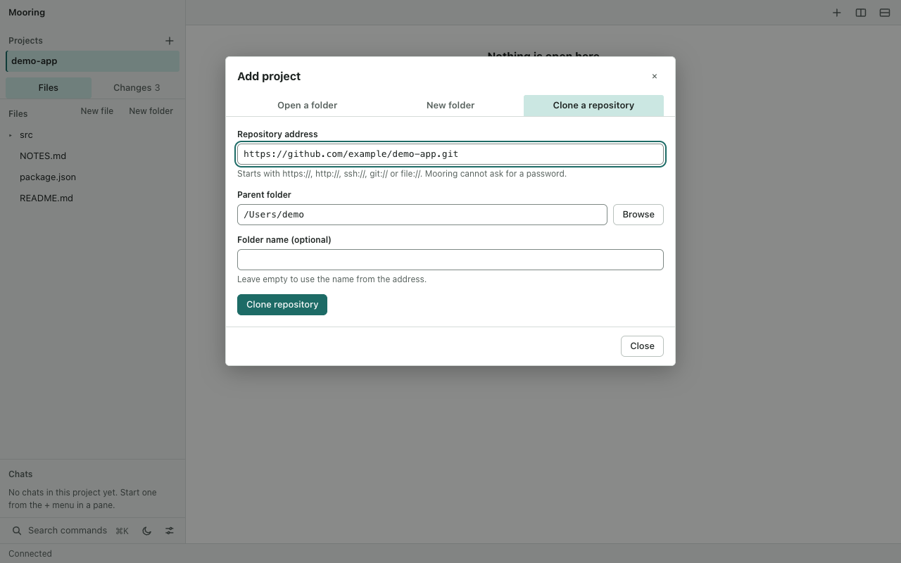
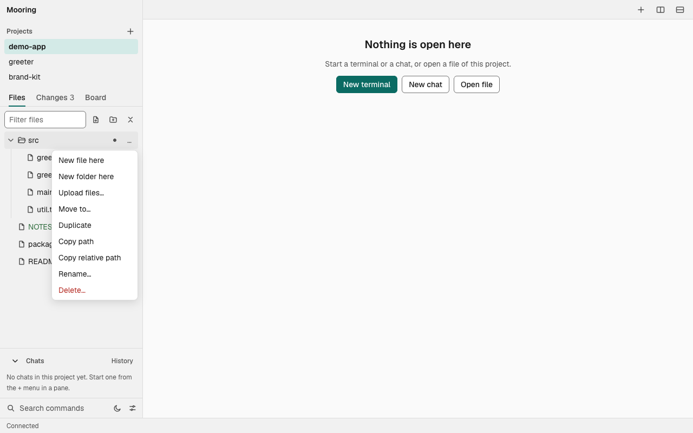
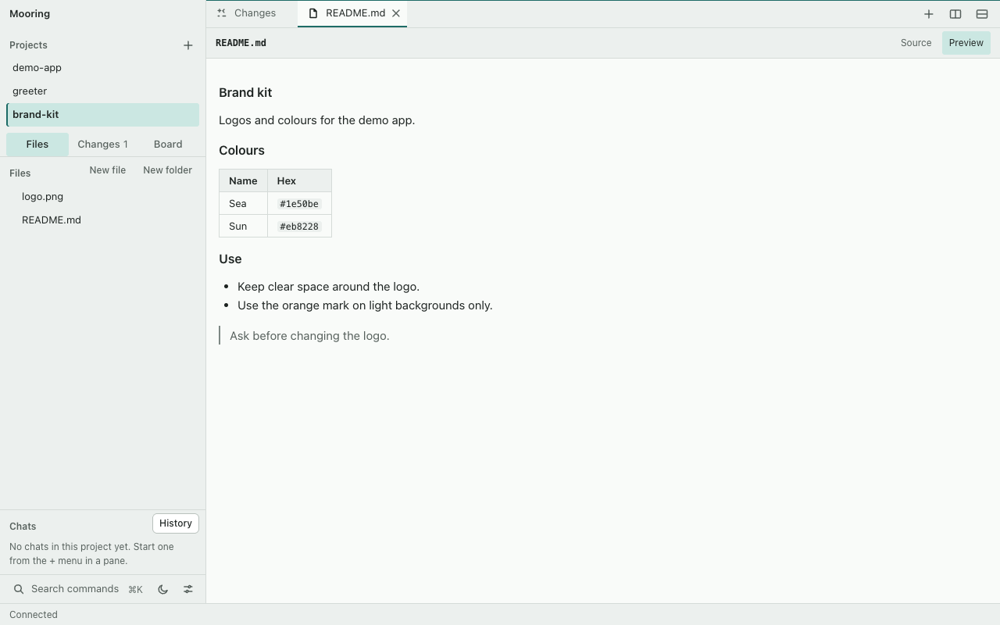
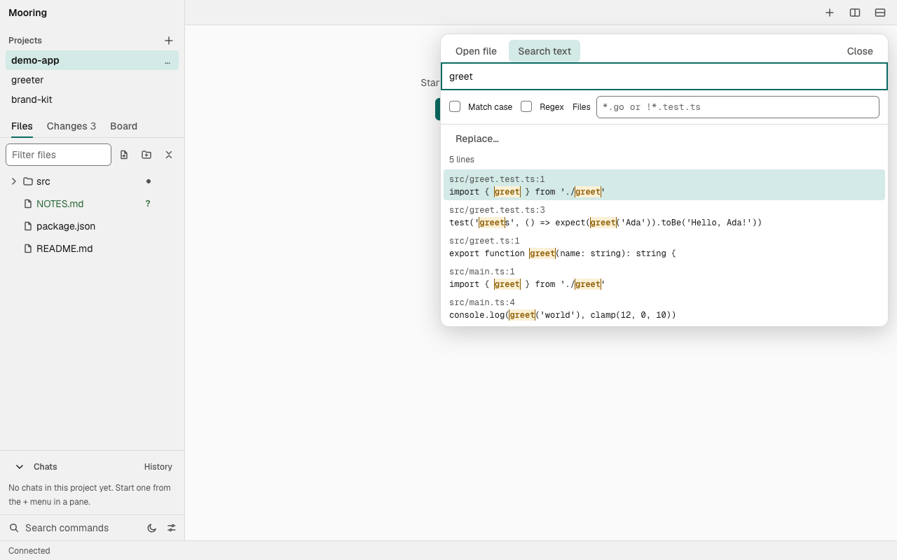

# Projects and files

A project is a folder on the computer running Mooring. Each project has its own panes, files,
changes and chats.

## Add a project

1. Click the "+" ("Add project") button beside "Projects" in the sidebar. The "Add project"
   dialog has three tabs.
2. To use a folder you already have, stay on "Open a folder". Type a path in "Folder on this
   computer" and click "Go", or click folders in the list. "Up one folder" goes back. Folders that
   are git repositories carry a "git repository" tag. Click "Open this folder".
3. To make a folder, pick "New folder". Choose the Parent folder (Browse and Hide folders show and
   hide the picker, and "Use this folder" confirms it), type a Folder name and click "Create
   folder".
4. To clone, pick "Clone a repository". Enter the Repository address, which starts with
   https://, http://, ssh://, git:// or file://. Mooring cannot ask for a password, so use a
   repository that needs none or a key or credential helper already set up. Choose the Parent folder.
   "Folder name (optional)" can stay empty to use the name from the address. Click "Clone
   repository".

## Work with the project list

- Click a project to switch to it.
- Drag a row to reorder, or use the "…" menu on the row: Rename, Move up, Move down, and
  "Remove from list…". Removing only drops it from the list. Its files stay on disk.
- If the folder has gone, the project says "The folder of this project is missing". Click "Choose
  another folder" or "Remove project".

## The file tree

Click "Files" in the sidebar to see the tree of the open project.

- The "New file" and "New folder" buttons at the top add to the folder you last clicked, or to the project folder if you have not clicked one.
- A single click previews a file in a tab that the next click replaces. Press Enter or
  double-click to keep it open.
- Keys: Up and Down move, Home and End jump, Right expands a folder, Left collapses it, F2
  renames, M moves, Delete deletes.
- Hidden and ignored entries show dimmed, tagged "(hidden)" or "(ignored)". Links are tagged "(link
  leaves the project)" or "(broken link)".
- A long folder shows "Showing N of M."
- An empty project says "This project folder is empty. Use New file to add one."

### The row menu

Open it with the "…" button on a row, or right-click. Folders have "New file here" and "New folder
here" and "Upload files…". Files have "Download". Every row has "Move to…", "Duplicate", "Copy
path", "Copy relative path", "Rename…" and "Delete…".

To rename a file or folder:

1. Open the row menu and click "Rename…", or select the row and press F2.
2. Type the new name in the box that appears and press Enter.

To move one:

1. Drag it onto a folder. Mooring moves it at once and shows "Moved X to Y." for 12 seconds.
2. Click "Undo" in that message to put it back.

Or open the row menu, click "Move to…", type part of a folder name and pick the folder.

If the new place already has that name, Mooring asks "X already exists in Y." Choose "Replace"
(the old file goes to the trash), "Keep both" or "Cancel".

### Delete and the trash

"Delete…" asks "Move X to the trash?" Click "Move to trash" or "Keep". Mooring has no undo for the
trash. Open the Trash in Finder to get a file back. Only moves have "Undo".

Where there is no trash (Linux), it asks "There is no trash to move it to. Delete X for good? This
cannot be undone." and the button reads "Delete permanently".

### Upload and download

To upload, drop files from Finder onto a folder, or use "Upload files…" in a folder's menu.
Folders cannot be dropped: Mooring says "Folders cannot be uploaded yet. Drop the files inside
it." A file over 100 MB is refused with "X is over 100 MB. Copy large files with a terminal."

To download, open a file's row menu and click "Download".

## The editor

Click a file to open it. The top shows the path and, for a file Mooring cannot change, a
"Read-only" tag. The editor has colours for the language, search, undo and, with a language server,
hover, completions and errors (see [Language servers](language-servers.md)).

To save: press Cmd+S (Ctrl+S elsewhere), or click "Save", which shows while the file has changes.
The state next to the path reads "Saving…", "Unsaved changes" or "Updated from disk". "Format"
shows when a language server can format the file.

Press Tab to indent. To leave the editor with the keyboard, press Esc, then Tab. Files over 2 MB
open without colours.

Some files do not open as text. A binary file says "This is a binary file, so it is not shown
here. Open it with another program." A file over 10 MB says "This file is over 10 MB, which is
more than the editor opens." Images show as pictures.

### Who changed each line

The Blame button in the bar above a file (also "Show who changed each line" in the command
palette) adds a column before the text. At the start of each run of lines it shows the short commit
id, the author and how long ago. Lines not committed yet say "Not committed yet". Hover a row to read the
commit's full summary; click it to open that commit. The bar also says it in words for the line
the cursor is on and has an "Open commit" button for it (also in the palette), which is how a
screen reader or the keyboard reaches it. The column is not in the tab order. Blame is off by default and
off again when you reopen the file.

While the file has unsaved edits the column is hidden, because the lines no longer match what Git
knows. It comes back after you save. A commit made elsewhere shows only after you turn Blame off and on again. A file that is not in Git yet says so and shows nothing.
Files on an SSH host have no Blame button. On a phone the author is left out to save width.

### Preview

Markdown (`.md`), CSV and TSV, and HTML files have a Source and Preview switch in the bar above
the file. Source is the editor and is where a file opens. A tab remembers its choice while it is
open. The editor tools (Format, Ask the agent) are hidden in Preview, and the file cannot be
edited there. Preview shows what is in the editor, unsaved edits included, and follows the file
when it changes on disk. Files on an SSH host have no Preview.

- Markdown is drawn like an agent reply. Raw HTML in it is shown as text, and links to files open
  in Mooring. Pictures are not loaded.
- CSV and TSV show a table with the first row as the header. Quoted fields, commas and line breaks
  inside quotes work. Only the header and the first 1000 rows are drawn; a note says so, and
  Source shows the whole file.
- HTML shows in a sandboxed frame. Scripts do not run, and the page cannot reach Mooring. Its
  links and style files do not load, and pictures load only when they are inline (`data:`), so a page that depends on them looks plainer.

A PDF (a name ending in `.pdf`, up to 50 MB) opens in the tab in the browser's own PDF viewer, with an "Open in a new tab" link above it. It has no Source switch and is not editable. If the file does not start like a PDF, the tab says so and offers "Open as text". A larger PDF says it is too big; open it with another program.

### Unsaved changes

- Closing a tab with edits asks "Close X without saving?" with "Save and close", "Discard changes"
  and "Keep editing".
- Closing or reloading the browser page warns while any file has unsaved edits.
- If the file changed on disk while you had edits, the editor says "This file changed on disk, and
  you have unsaved edits here." Click "Load the file from disk" to take the disk version, or
  "Overwrite the file on disk with my version" to keep yours.
- If you save and the disk version is newer than the one you opened, it says "Not saved. The file
  on disk is newer than the version you opened." and offers the same two buttons.
- If the file was deleted, it says "This file was deleted from disk. Save to create it again."

### Ask an agent about lines

Select lines and click "Ask the agent about these lines". The lines become an attachment in your
chat. See [Agent chats](agent-chats.md). The button reads "Select lines to ask the agent" until
you select something, and it works on local files only.

## Find a file or text

Press Alt+O or Cmd+P (Ctrl+P elsewhere; in a focused terminal on Linux, use Alt+O) to open "Find in project". The dialog has two toggles,
"Open file" and "Search text". Alt+F or Cmd+Shift+F (Ctrl+Shift+F elsewhere) opens it on "Search
text". In a focused terminal off a Mac, Ctrl+Shift+F searches the terminal's output instead, so
use Alt+F there.

To open a file by name:

1. Open the dialog on "Open file".
2. Type part of the file name. Up and Down move through the list.
3. Press Enter to open the file.

To search text:

1. Switch to "Search text" and type the text to find in this project.
2. Optionally tick "Match case" or "Regex", or fill "Files" with a pattern such as `*.go` or
   `!*.test.ts` to include or leave out files.
3. Press Up and Down to move, Enter to open a match. Esc closes the results.

It shows "Searching…", then "N lines". If there are too many matches it says "Showing the first N
lines. Narrow the search to see the rest." With none, "Nothing found for “q”." If files changed
since you searched, it says "Files changed since this search."

### Replace in files

With "Search text" open, click "Replace…" or press Alt+R in the panel (on a Mac, not while the cursor is in the search box). Type the "Replace with" text
and click "Preview replace" (or press Enter). The preview reads, for example, "Replace in 2 files, 3
places", and lists each file with its changed lines, before and after. It says which files are open in
an editor (changed there and left unsaved, so Cmd+Z or Ctrl+Z undoes it) and which are saved to disk
at once. Files it could not read are listed as not changed. Click "Replace" to make the change, or
"Back" (or Esc) to go back. The result lists the files changed and any that failed, each with the
reason.

With "Regex" on, `$1` and `$<name>` in the replacement take the groups of the match. Otherwise the
text goes in as typed, and an empty field deletes the matches. The search must have finished and
listed every match; if it stopped early, narrow it with "Files". A file with unsaved changes in a tab
that is not showing stops the whole replace before anything changes.

Next: [Terminals](terminals.md).
